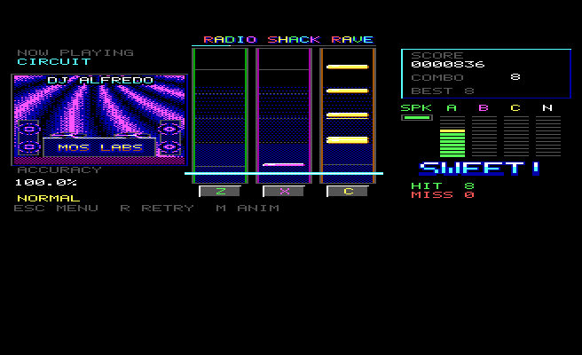

# Radio Shack Rave

Three lanes. Three keys. The sound hardware already in your Tandy.

Radio Shack Rave is a 320×200, 16-color rhythm game for Tandy 1000 EX-class PCs. Tap **Z / X / C** as notes cross the hit line, build a combo, and chase a better grade. It includes an attract loop, a shuffled song catalog, high scores, and a DJ Alfredo visualizer.



**SPK** is the speaker on/off light; **A/B/C** are PSG tone levels and **N** is PSG noise. This is an emulator capture of the original CC0 demo.

## Your Tandy has an extra voice!

The expressive sound engine combines **three PSG tone channels, one PSG noise channel, and the PC speaker's square-wave voice**. No add-on sound card is required in the supported exclusive Tandy DOS configuration.

The speaker adds **one bass note at a time** and **31 lower note positions: D0–G♯2**, two octaves plus seven semitones below the PSG's A2 floor. These are extra pitches, not 31 simultaneous voices. MIDI inputs below D0 are octave-folded upward, and high PSG pitches are coarsely quantized; accepting a MIDI note number does not mean every note has a distinct native pitch.

- **Prepared expressive playback:** prepare the complete supported MIDI arrangement on a modern computer, then replay its PSG/PIT states on the 8088. Existing envelopes, vibrato, pitch bend, modulation, volume/expression and sustain come from the shared sound renderer. No imported instrument bank is bundled.
- **Music and gameplay stay separate:** the full soundtrack keeps playing while an independently reduced RBG chart supplies the notes you tap. Missing a chart note does not cut the soundtrack.
- **Five sound indicators:** four PSG meters (**A/B/C/N**) plus a labeled **SPK** on/off light follow the last successfully emitted sound state. The fixed-volume speaker has no invented amplitude meter. Dirty drawing stays bounded in lean and animated modes.
- **Lean by default:** press **M** to toggle the optional decorative animation, or launch with `/ANIM`.
- **Presentation sounds restored:** the original intro, title and score-counting effects play around the soundtrack, with guarded silence between phases.

The user played the accepted full-song baseline with **Call Me on a real Tandy**, reporting that the sound was amazing and the game felt great. The supplied commercial MIDI, its chart, prepared stream, screenshots and audio are **not distributed**. Hardware feedback on v0.7.0 identified the missing speaker indicator. This patch adds it; the new indicator has emulator qualification and its fresh physical test remains pending. See [qualification and measured costs](docs/QUALIFICATION.md).

## Play

Use the DOS runtime package from [Releases](https://github.com/astrobleem/radio-shack-rave/releases/tag/v0.7.1-five-indicators), or the `runtime/` directory in the source tree. Run `PLAY` for **Circuit After Hours**, the original bundled composition. Run `DEMO` for the new original prepared-sound example.

| Key | Action |
| --- | --- |
| Z / X / C | Hit the three lanes |
| Space | Start the selected song |
| R | Retry |
| M | Toggle decorative animation |
| Escape | Return to the title; exit from the title or splash |

Target: an 8086/8088 Tandy DOS session with the supported PSG and speaker hardware, 640 KiB conventional memory for full-song prepared playback, and exclusive hardware ownership. The runtime restores the keyboard/vector, video mode and sound owner on exit. It is not a Windows DOS-box audio driver.

## Bring your own MIDI

Use music you are authorized to use. The repository includes only original, permissively licensed music: [Circuit After Hours](music/LICENSE.TXT) and the [prepared demo](music/DEMO-LICENSE.txt). No commercial MIDI or derived arrangements are included.

On a modern computer, install Python 3 and a C compiler, then fetch the exact public sound dependencies:

```sh
python tools/fetch_sound_deps.py
python tools/rave_prepare.py --song YOUR.MID --out YOUR.RWS --trace YOUR-CYCLES.csv --evidence YOUR-PREPARED.json
```

Create and review a matching chart with the [MIDI workbench](docs/MIDI-WORKFLOW.md):

```sh
python tools/rave_workbench.py YOUR.MID
```

Save the chart as `YOUR.RBG`, copy the chart and prepared stream beside the DOS executable, and launch:

```bat
RSRAVE YOUR.RBG /STREAM YOUR.RWS /LEAN
```

The live `/MIDI YOUR.MID` route is also available, but parsing and synthesis cost more CPU. The bounded renderer accepts supported SMF files up to 60,000 bytes, 16 tracks and 32,768 channel events; it rejects unsupported inputs. Chart selection is deliberately lossy and does not replace or rewrite the full soundtrack. See [the playback contract](docs/FULL-MIDI-PLAYBACK.md).

## Build and shared libraries

This release versions its portable MIDI parser/synth in [libtandy](https://github.com/astrobleem/libtandy/tree/main/sound) and its prepared-playback producer in [libwintandy](https://github.com/astrobleem/libwintandy/tree/main/sound). `LIBTANDY.PIN.json` and `LIBWINTANDY-PREPARER.PIN.json` record the exact public commits and file hashes. The `deps/` sources can also be supplied with `LIBTANDY` and `LIBWINTANDY` environment variables.

- **MSC6 reference:** configure your licensed compiler, run `python tools/fetch_sound_deps.py`, then `BUILD.BAT`.
- **OpenWatcom 2:** set `WATCOM` and run `tools/build_ow.sh` on Linux/macOS/WSL. The combined game and MIDI objects use the medium code model to fit separate 16-bit code segments; the MSC6 reference keeps its qualified small model.
- **Host checks:** `python tests/run_checks.py --cc gcc`.
- **Prepared replay checks:** `python tools/check_rws.py --stream runtime/DEMO.RWS`.

The C compiler is needed for preparation/building, not to run the DOS game. CI tests the original licensed fixtures, the public prepared demo, and a fresh OpenWatcom DOS build separately from the native-qualified MSC6 runtime. Compiler binaries, ROMs and operating-system files are not bundled.

Game and tools: [GPL-3.0](LICENSE). Shared sound components retain their MIT/GPL notices. Original music has its own grants linked above. RAVE is an independent hobby project, with no official RadioShack sponsorship or affiliation.
